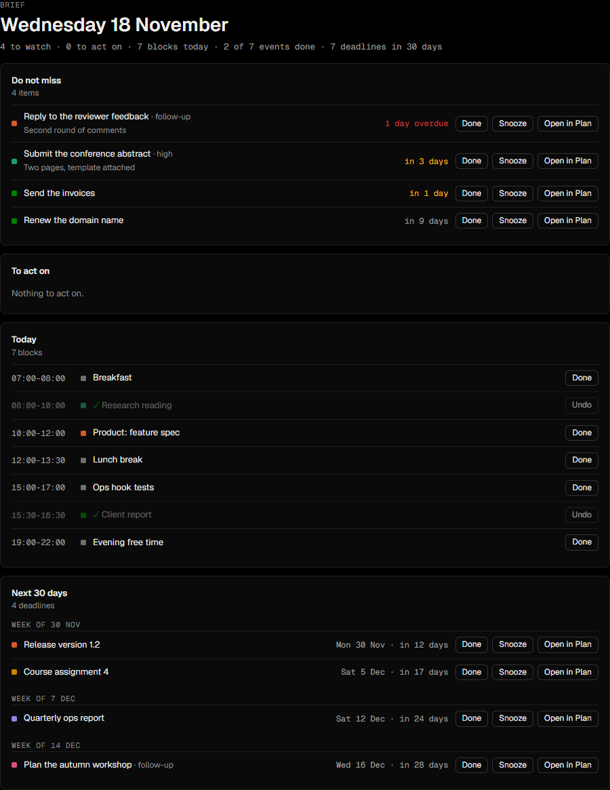
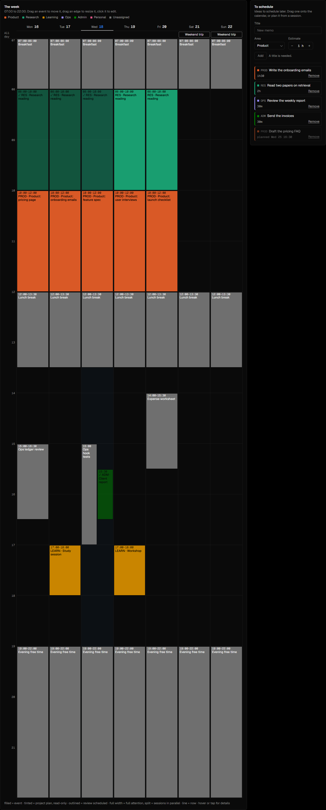
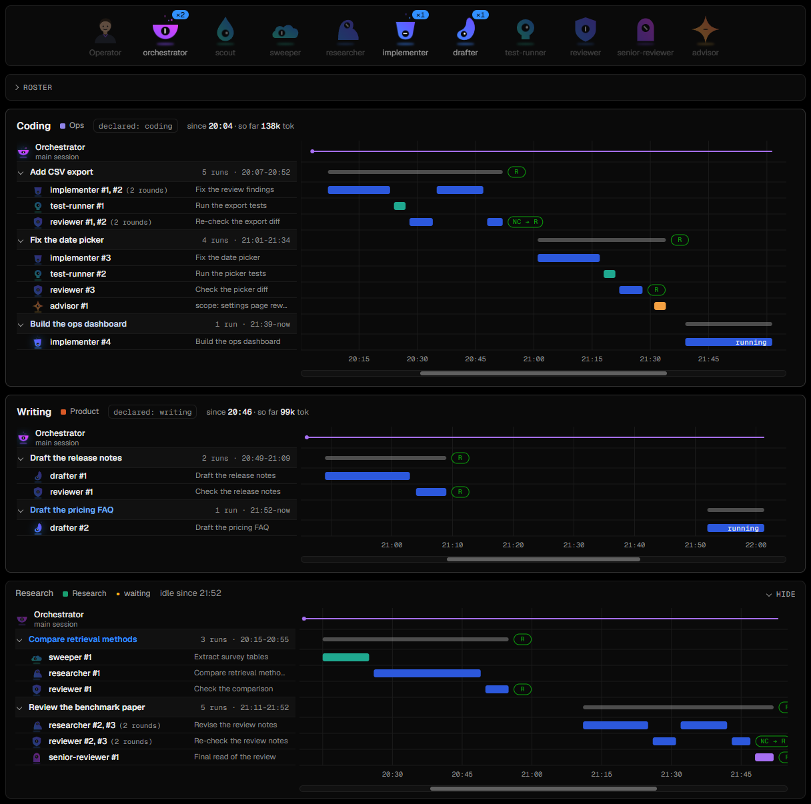
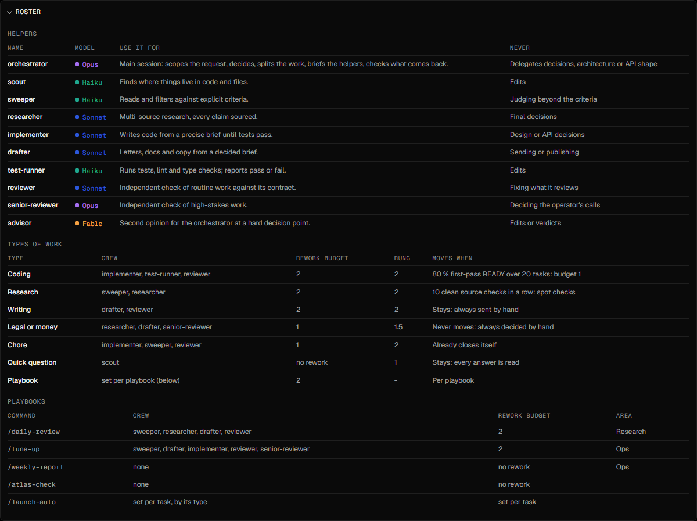
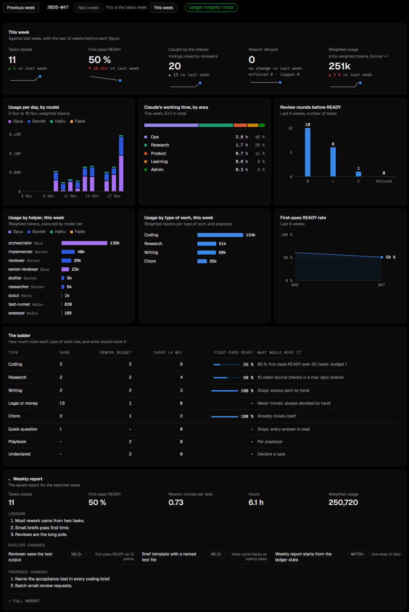
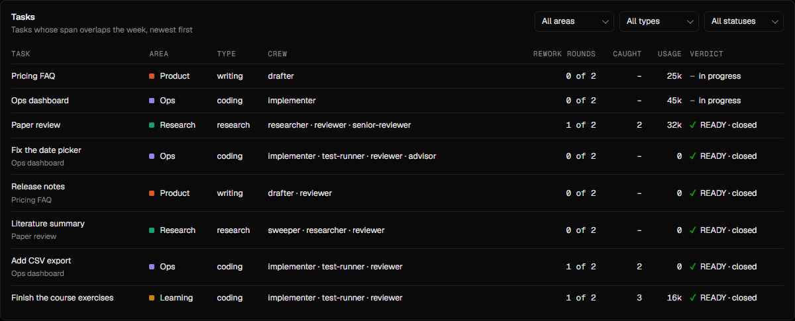

# Atlas

Atlas is a local control room and a tamper-evident record for work done with Claude Code. The work happens in
Claude Code sessions. Atlas shows those sessions live, records what each one did in an append-only ledger,
checks that the record has not been edited, and keeps deadlines, a calendar and a memo rail of ideas to schedule next to it.

It runs on one machine and reads only local files; the only network use is the web fonts and the optional outside anchor's git push. Everything in this repository is
standard-library Python plus plain HTML, CSS and JavaScript (no build step). The only Python dependency is `pyyaml`.



*Brief opens first. Do not miss lists deadlines and follow-ups that are overdue or close, with Done, Snooze and Open in Plan; To act on shows read-only signals (here empty); Today lists the day's blocks with a Done or Undo toggle; Next 30 days groups the later deadlines by week.*

## What it does

| Screen | Key | What it shows |
| --- | --- | --- |
| Brief | `b` | The default screen. Do not miss, To act on, Today and Next 30 days. Deadlines and follow-ups live in the schedule file and are edited by chat (`plan_day.py` ops). To act on holds read-only signals from the team, such as sessions waiting for the operator. |
| Plan | `p` | Week view with up to 3 shared blocks running in parallel, events that can repeat (including on the nth or last weekday of a month), and a To schedule memo rail of ideas to schedule later, dragged onto the calendar or planned from a session. |
| Team | `t` | Live sessions and their helpers (a session closed with `: team-done` shows done, not waiting), one delegation chart per session, and the roster of named helpers and what each may not do. |
| Ledger | `l` | A weekly report summary, tasks, review rounds, first-pass rate, usage by model and helper, working time by area (active time: helper runs plus gaps of up to 15 minutes, not wall-clock), ledger integrity and bypass attempts. |

The screens are in this order in the navigation: Brief, Plan, Team, Ledger.



*The week view, Monday to Sunday, with the To schedule memo rail on the right. Shared blocks of different areas run side by side (Wednesday afternoon shows two). Full-attention blocks (meals, evenings) span the column and overlap nothing. A check mark shows a block marked done, and all-day events sit in a row under the day names.*



*One group per piece of work, with one-line rows per helper call and a bar on the shared time axis. Verdict chips close each group: R for READY, "NC → R" for NEEDS CHANGES then READY. A bar still running is labelled "running". Scrolling over a chart zooms it, the time bar below it drags the window, and the default window is the last 2 hours and the next hour.*



*The roster lists every named helper with its model and what it may not do (nine helpers, including `advisor`, a second opinion for the orchestrator at hard decision points, never a verdict), then the types of work with their rework budgets and the playbooks.*



*The top row compares this week with last week (tasks closed, first-pass READY rate, findings caught, rework refused, weighted usage); the charts below show usage by model, helper and type of work, and the ladder of rework budgets. The weekly report summary at the bottom gives its figures, lessons, a scoreboard of earlier changes and proposed changes; the full report is a collapsed section under it.*



*One row per task with area, type, crew, rework rounds against the budget, findings caught, usage and verdict. A row reads READY · closed when a passing review covers it and "in progress" while work is open.*

## How it works

- **Hooks feed the ledger.** `hooks/atlas_hook.py` is a Claude Code hook. It records session starts, prompt events (never their text),
  helper hand-offs, edits and reviewer verdicts as one JSON line per event, each chained to the previous one by a hash.
- **The ledger is the single source of truth.** `cockpit/ledger2/` derives tasks, review rounds, usage and integrity
  from the event files. Nothing in the UI is stored twice.
- **Rework budgets can be enforced.** `workflows.yaml` sets how many NEEDS CHANGES verdicts each type of
  work may get. Rounds are counted per reviewer tier: `senior-reviewer` is one tier, every other reviewer the other, so a
  task that goes through a routine review and then a senior review has a budget for each. Record is the default mode: every guard below computes its decision and logs it as a would-refusal
  (visible on the Ledger screen), but allows the action. Enforce mode (`py -3.12 tools/hooks_mode.py enforce`, back with
  `record`) makes these guards act:
  - *Rework budget:* once either tier of a task has more NEEDS CHANGES verdicts than its type's budget, further builder spawns and the
    main session's own edits on that task are refused, until the operator types `/grant-rework`. Reviewers, test runs,
    scouting and `advisor` consults are never refused.
  - *Edit limit:* the main session's 6th edit on a task since the last `implementer` or `drafter` launch is refused, with a
    message to hand the rest to a builder. Helpers' edits are never counted. Memory files are exempt, and a crew with no
    `implementer` or `drafter` (research only) is never stopped. A softer reminder, in every mode, comes at the 3rd edit.
  - *Done-lock:* a task with changes that no passing review covers cannot be closed with `: team-done`, and at Stop the
    main session is sent back once per version of the work to run the check or say plainly that it is unchecked.
  - *Quick-question guard:* while a task is declared `quick-question`, file edits and any helper other than `scout` are refused.

  A reminder, never a refusal: when a reviewer is launched on a coding task after an `implementer` returned and no
  `test-runner` has run since, the hook adds a line asking for the full test run before the review.

  Three guards apply in every mode, record included: the publish gate, the config gate and the ledger and hooks guard (next three items).
- **Plan links are automatic when unambiguous.** A declared task or playbook opened without `task:<id>` links to the one timed,
  not-done calendar block of the same area running now or starting within 15 minutes; none or several links nothing.
- **The record guards itself.** A command that touches the ledger folder or the installed hooks is denied, and the
  attempt is logged. A broken hash chain shows on the Ledger screen until the operator acknowledges it with `/ack-break`.
- **Publishing needs a yes.** A command that would publish (a push, a release, a deploy, making a repository or gist public) is refused in every mode until the operator types `/allow-publish`, which allows a few publishes for 30 minutes.
- **Instructions and settings need a yes.** An edit to an instruction, skill or settings file (`CLAUDE.md`, `SKILL.md`, the `.claude` agents, commands, hooks and settings), or a shell command that changes one, is refused in every mode until the operator types `/allow-config`, which opens a 15-minute window in that session.
- **An outside anchor (optional).** `tools/anchor_ledger.py` pushes one hash per ledger day to a separate git repository, so a ledger that was edited and re-chained afterwards no longer matches.
- **Planning is plain YAML.** `cockpit/plan/` reads and writes a schedule file and a task file with optimistic
  versioning; hand edits are detected and win.
- **Parallel planning.** An area is `shared` or `full` attention (`areas.yaml`). Up to 3 shared blocks may overlap; a full
  block overlaps nothing. The week view packs shared blocks into tracks.
- **Planning by chat.** `tools/plan_day.py` shows the calendar and applies a list of edits (add, move, delete, retitle,
  done, undone, memo, place, and the deadline ops `deadline`, `deadline-done`, `deadline-move`, `deadline-delete`) through the running cockpit, so every guard of the Plan engine applies. Its `deadlines` command lists what the Brief shows. `tools/find_plan_item.py` finds a
  block or task id by name. The `memos` command lists the To schedule memos, `memo` adds one and `place` puts one on the calendar (it stays greyed until its block is done). The Plan screen itself moves, resizes and edits blocks, and memos can be dragged onto the calendar. Marking a block done is manual and
  optional (a button in the event form, or the `done` op).
- **Areas are one short file.** `areas.yaml` is the only place an area (name, colour, folders, keywords) is defined.
  `tools/check_look.py` checks the colours for colour-blind safety.

The binding contracts (event formats, HTTP API, hooks, front end) are in [`docs/v2/contracts.md`](docs/v2/contracts.md).

## Run it

```
pip install -r requirements.txt
py -3.12 cockpit/server.py --port 8765
```

Then open `http://localhost:8765`. The server binds to loopback only. Point it at your own data with
`ATLAS_SCHEDULE_FILE`, `ATLAS_TASKS_FILE`, `ATLAS_PLAN_VERSION_FILE`, `ATLAS_LEDGER2_DIR`, `ATLAS_AREAS_FILE` and
`ATLAS_WORKFLOWS_FILE`. The areas, workflows, planning rules and registry in this repository are synthetic examples.

To record real sessions, install the hook with `py -3.12 tools/install_hooks.py --dry-run` first, then without `--dry-run`.

## Layout

| Path | Contents |
| --- | --- |
| `cockpit/` | The server, `core/` helpers, `ledger2/` (the ledger), `plan/` (the planner and the Brief read), and the front end in `web2/`. |
| `hooks/` | The Claude Code hook, the team-events hook, and the user-only skills `/grant-rework`, `/ack-break`, `/allow-publish` and `/allow-config`. |
| `tools/` | Installers and utilities: hooks, skills, automatic sessions, weekly report, daily check, look check, planning by chat (`plan_day.py`, `find_plan_item.py`). |
| `skills/` | Skills owned by this repository: `launch-auto`, `weekly-report` and `atlas-check`. |
| `docs/v2/` | The contracts and the anchor setup guide. |

## Tests

```
py -3.12 -m pytest -q
```

Tests use temporary directories and synthetic fixtures. They never read a real ledger, calendar or task file.
Node 20 or newer runs the front-end unit tests as part of the same command (skipped if node is missing).

See `STATS.txt` for the size of the code base at export time.

## About this copy

This repository is generated from a private working repository by an export script that copies an explicit
allowlist of files, replaces personal fixtures with synthetic ones, and fails if any private string is left.
Optional private panels of the original (mail and finance) are not included.
