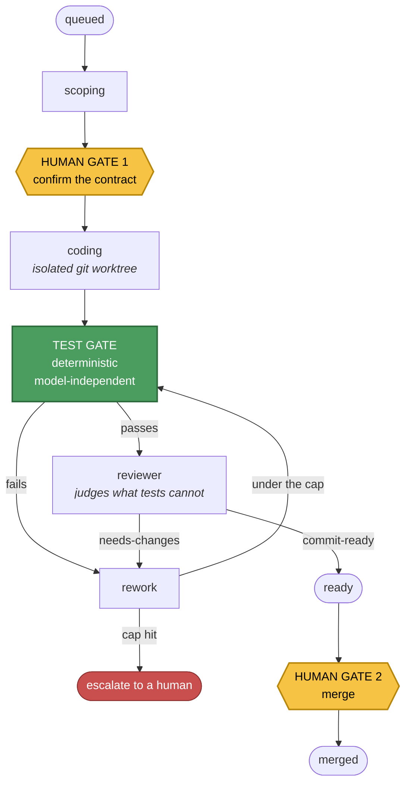

# Atlas

**An orchestration substrate that decides how much autonomy each task has earned — and stops for a human at exactly two points.**

Atlas dispatches work across projects to coding agents running in isolated git worktrees, runs each
project's hard test gate, has a reviewer judge the diff against the contract and the **real** test
result, and then waits. It does not merge. It does not publish. It does not send.

I run it every day.

**14,145 lines of Python · 555 tests · 1,947 lines of design records**

---

## The argument

Everyone can get a model to write code now. That is not the hard part, and it stopped being a
differentiator some time ago.

The hard part is deciding **when to believe the output** — and the answer cannot be another model,
because two instances of the same model share the same blind spots. Stacking "LLM checks LLM" buys
far less than the head-count suggests.

> **You do not engineer the automation. You engineer its _validator_.**

The loop, the prompt, the fan-out are delivery mechanisms. The validation layer is the object of
design. Everything in this repo follows from that one sentence.

---

## The ladder

Every capability Atlas takes on is placed on this ladder before it is built, and must declare its
validation metric. The rule: **pick the lowest rung that clears the trust bar for this task.**

| Rung | Pattern | Validation layer | Choose when |
|---|---|---|---|
| **0** | Deterministic | The code's own tests | No judgment is needed — it is a calculation, lookup, or rule |
| **1** | One-shot prompt | None / implicit | One pass is reliable **and** a wrong answer is cheap |
| **1.5** | One-shot + verify | A deterministic oracle, applied once | One pass usually works, but a wrong answer is **costly** |
| **2** | Loop against a validator | Something that can score progress and define "done" | One pass genuinely can't do it, and a validator exists to close the loop |
| **2.5** | Fan-out + select | A comparator that can **rank** candidates | The solution space is wide and any single attempt is mediocre |
| **—** | **Never automate** | The human | Irreversible, outward-facing, or financial |

Two consequences that do most of the work:

- **Never use an LLM for what code can do reliably.** A mis-rung does not fail cleanly, it cascades.
  One real case: *"launch the next task"* was built on an LLM deciding *which* task. But "the next
  task" is a plan lookup — rung 0. That single mis-rung caused three failures at once: it launched
  the wrong project, dropped the structured dispatch action, and spoke the result twice. Rebuilding
  it as a deterministic lookup fixed all three in one change.
- **Where no validator exists, autonomy is not available at any price.** The honest answer is a
  human gate and a lower rung — not a weaker automatic gate that waves work through on a model's
  opinion.

The live classification of everything that runs, and at which rung, is
[`automation-map.yaml`](automation-map.yaml). The framework is
[`docs/automation-patterns.md`](docs/automation-patterns.md). **If you read one file, read that one.**

---

## How a job actually flows



The two amber boxes are the only places a human is required. Everything between them runs unattended
— **because the green box exists.**

Three properties make that safe rather than reckless:

1. **The test gate is independent of the model.** It is the project's own suite, run unsandboxed in
   the worktree after the coding session. Independence is the source of trust, not head-count.
2. **The reviewer sees the real test result**, never the worker's account of it. A worker that could
   narrate its own gate result would be grading its own exam.
3. **Rework is capped.** A loop that cannot converge escalates to a human instead of burning tokens
   discovering that it cannot converge.

---

## What the gate produces

Every job leaves a record. These are the fields that decide its fate — the shape is real, the
contents here are an illustrative example rather than a captured transcript:

```json
{
  "status": "ready",
  "test_cmd": "py -3.12 -m pytest -q",
  "test_output": "94 passed, 3 skipped in 12.41s",
  "review_verdict": "needs-changes",
  "review_notes": "Contract asked for idempotent retries; the handler retries but
                   does not dedupe on the request id, so a replay double-writes.",
  "rework_count": 1,
  "merge_requested": false
}
```

Note what that record makes impossible: `review_verdict` was reached while looking at
`test_output`, so a green suite cannot be *claimed*. And `status: ready` with
`merge_requested: false` is the whole design in two fields — the work is finished and it is
still waiting.

The test suite for the engine itself is real and reproducible:

```
$ py -3.12 -m pytest -q
555 passed in 92.50s
```

---

## Measuring the gate itself

A gate you cannot measure is a gate you end up trusting on feel. So the engine writes one
append-only file, `ledger/events.jsonl` — one line per thing that happened: a state change, a test
run, a reviewer verdict, an escalation and **who answered it**, a merge, a revert, and the token
figures of every phase. Nothing is edited, pruned or summarised in place.

Three rules, each a property of the code rather than a habit:

- **Events only, statistics derived.** Nothing computed is ever stored. A formula found to be wrong
  is fixed once and corrects every past week; a metric nobody has thought of yet is answerable from
  July's data in December.
- **No efficiency figure without the quality figures beside it.** The token block cannot be built
  unless rework rate, reviewer rejection rate and revert count come with it. Tokens can always be
  driven down by doing worse work, and a chart that let you forget that would be worse than no chart.
- **The public export cannot leak.** The ledger holds task text and reviewer notes about real client
  work. The export path emits numbers only, with projects aliased by ordinal, and a recursive check
  asserts that every leaf is a number before anything is returned. A test poisons every text field
  and proves none of it can come out.

The number the ledger exists to move is **hours the machine spent blocked waiting on a human**. The
comparison that licenses more autonomy is read from it directly: revert rate on work a human approved
against revert rate on work that went through ungated. If the second is no worse than the first, the
approval was buying time, not safety — and the ungated category widens on evidence rather than nerve.

At the time of this snapshot (September 2026) a monitor is answering escalations in **shadow mode**:
it writes its would-be decision beside every human one and merges nothing. At the end of that week
the ledger says how often the two agreed, and that count — not confidence — decides whether it gets
a real decision. The design
is [`docs/ledger.md`](docs/ledger.md); the code is `dashboard/ledger.py`.

---

## The worked example

The projects in [`registry.yaml`](registry.yaml) are **fictional**; the real registry this repo was
extracted from is private. They are kept deliberately varied, because the ladder is only legible
when you can watch it reach *different* conclusions about different work:

| Example project | What it is | Gate | Rung |
|---|---|---|---|
| `orchard-api` | A backend service | hermetic `pytest` | **2** — the fullest gated instance |
| `orchard-site` | A public website | `npm run build` | **1.5** — the build proves it *renders*, never that it is *true* |
| `orchard-journal` | A newsletter | **none, deliberately** | **1.5** — nothing here is objectively checkable |
| `orchard-ops` | Business admin | none | *no entry at all* — nothing running to classify |
| `almanac` | A forecasting engine | frozen holdout | **0** at runtime, **2** for parameter search |

`orchard-api` and `orchard-journal` are the pair worth comparing. Same doctrine, same machinery,
**opposite conclusions** — because the validator question has a different answer. Writing quality
cannot be gated, so it gets a human and an honest rung rather than a gate that only looks like one.

---

## Where to look

| Path | What it is |
|---|---|
| [`docs/automation-patterns.md`](docs/automation-patterns.md) | **Start here.** The governing framework |
| [`automation-map.yaml`](automation-map.yaml) | The self-model — every capability, its rung, its validator |
| `dashboard/worker.py` | The gate engine and the multi-worker scheduler |
| `dashboard/dispatcher.py` | Job lifecycle, contracts, planner and schedule writes |
| `dashboard/ledger.py` · `ledger_report.py` | The append-only event ledger, its derived statistics, and the numbers-only public export |
| [`docs/ledger.md`](docs/ledger.md) | Why the ledger records what it records, and what each statistic is for |
| `dashboard/brain.py` · `brainkeeper.py` | The memory layer — a markdown vault only *code* may write to |
| `dashboard/schedmath.py` | The deterministic collision guard every schedule write path consults |
| `dashboard/vault.py` | The deterministic vault-lint that gates the one write-authorized agent |
| [`docs/agentic-structure.md`](docs/agentic-structure.md) | Agents, procedures, and the multi-worker engine |
| [`CLAUDE.md`](CLAUDE.md) | The contract between the operator and any agent working in this repo |

**The memory layer is worth a look** ([`docs/brain.md`](docs/brain.md)). Projects carry their own
decision record in a markdown vault, so an agent starting cold reads what was already settled instead
of re-deciding it. Exactly one function can write a note to disk, and it is deterministic — a model
may only *propose*. A corpus that models could write to would silently fill with model-invented
facts, and a memory you cannot trust is worse than no memory, because you stop checking it.

---

## What is not in this repo

This is a **dated snapshot of the engine**, not a mirror of a running system, and two things were
deliberately left out:

- **The control center** — the operator-facing UI. It is the layer about *my* life rather than about
  the system, so it is excluded. Code comments still refer to it as the consumer of a heartbeat or a
  badge; that consumer simply is not here.
- **The real project registry and its vault.** Replaced by the worked example above.

The engine here is the August 2026 extraction. One piece was lifted from the current tree in
September because it stands alone: the ledger (`ledger.py`, `ledger_report.py`, their tests and
design record). The worker in this snapshot predates it and does not yet write to it; the monitor that
reads it is still being measured and is not here at all.

The engine is complete and the tests run. Nothing was removed to make the numbers look better.

---

## Running it

```bash
pip install -r requirements.txt
py -3.12 -m pytest dashboard -q     # 555 tests, ~90s, no network, no keys
```

The engine itself is **stdlib-only** — `subprocess`, `pathlib`, `json`, `datetime`, `threading`,
`concurrent.futures`, `urllib`. That is not an accident: every dependency is something that can break
a gate run for a reason unrelated to the code being gated, so the parts that decide whether work is
trustworthy have none. `pyyaml` reads the config plane; `streamlit` is needed only for the optional
read-only dashboard.

Models are reached over plain HTTP (local) or through a CLI (hosted), so swapping either is a config
change rather than a code edit — see [`docs/model-agnosticism.md`](docs/model-agnosticism.md).

---

*Built by [Evan Mazurier](https://github.com/evan-mazurier).*
