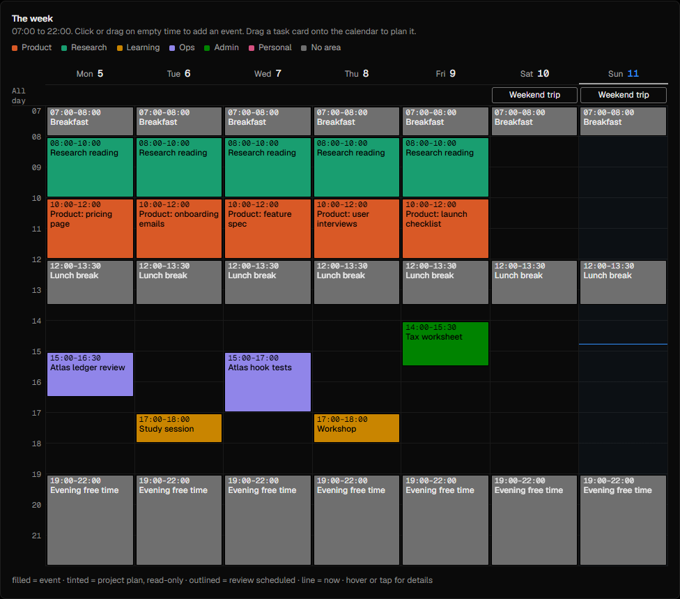
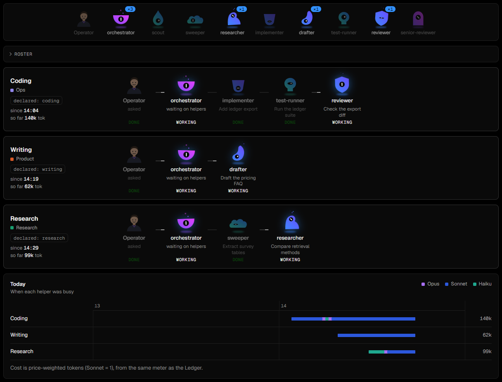
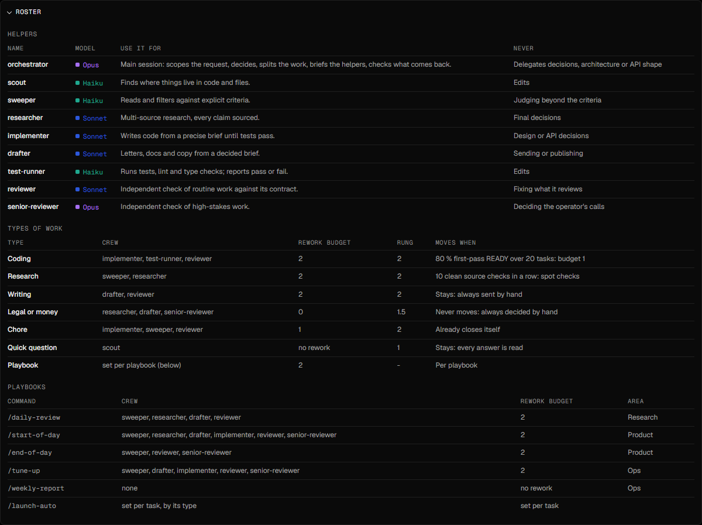
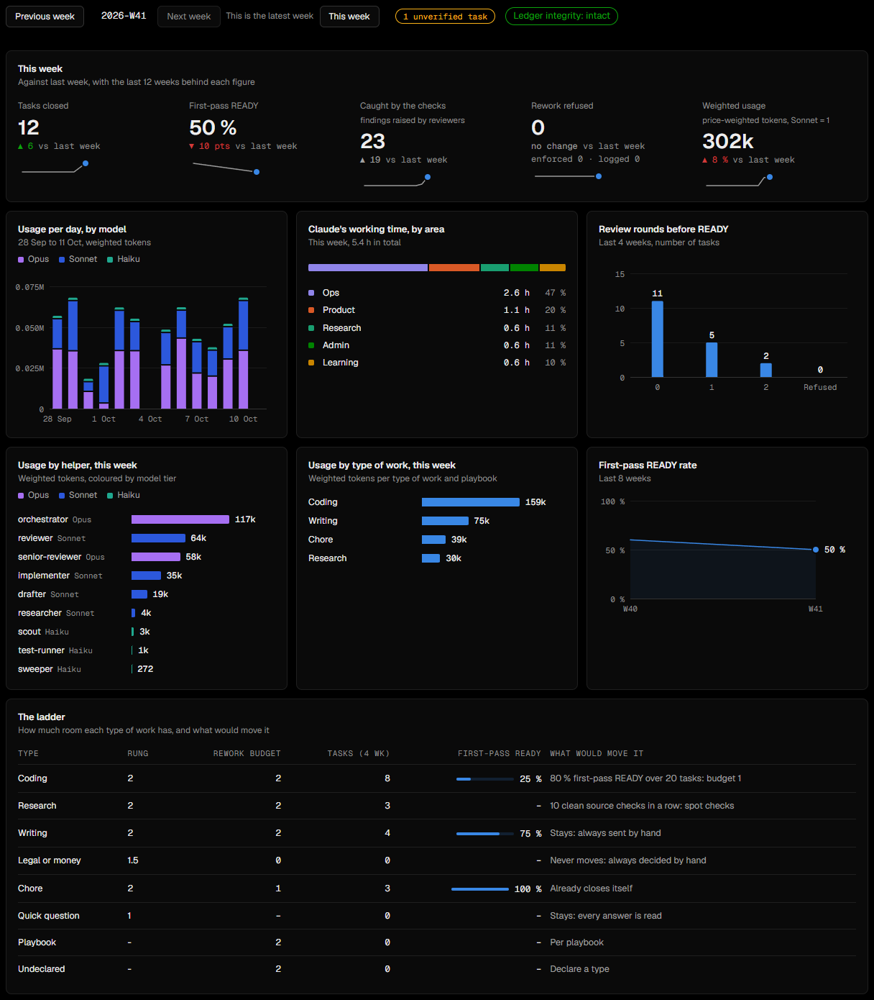
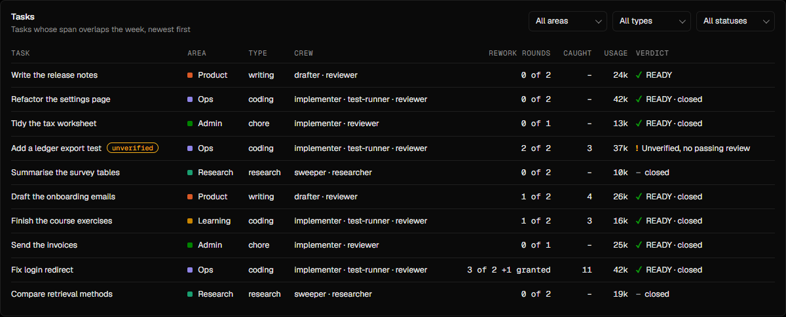

# Atlas

Atlas is a local control room and a tamper-evident record for work done with Claude Code. The work happens in
Claude Code sessions. Atlas shows those sessions live, records what each one did in an append-only ledger,
checks that the record has not been edited, and keeps a calendar and task lists next to it.

It runs on one machine and reads only local files; the only network use is the web fonts and the optional outside anchor's git push. Everything in this repository is
standard-library Python plus plain HTML, CSS and JavaScript (no build step). The only Python dependency is `pyyaml`.



## What it does

| Screen | Key | What it shows |
| --- | --- | --- |
| Plan | `p` | Calendar and day view, task lists per area, a review tray for finished automatic work. |
| Team | `t` | Live sessions and their helpers, a timeline of the day, the roster of named helpers and what each may not do. |
| Ledger | `l` | Tasks, review rounds, first-pass rate, usage by model and helper, ledger integrity and bypass attempts. |



*Each running session shows its type of work and the helpers it has called, with the busy ones lit; the timeline below shows when each helper was busy, coloured by model.*



*The roster lists every named helper with its model and what it may not do, then the types of work with their rework budgets.*



*The top row compares this week with last week (tasks closed, first-pass READY rate, findings caught); the charts below show usage by model, helper and type of work, plus the ladder of rework budgets.*



*One row per task: the rework column reads "3 of 2 +1 granted" where the operator added a round, and the verdict column separates READY from unverified work and from tasks with no verdict yet.*

## How it works

- **Hooks feed the ledger.** `hooks/atlas_hook.py` is a Claude Code hook. It records session starts, prompt events (never their text),
  helper hand-offs, edits and reviewer verdicts as one JSON line per event, each chained to the previous one by a hash.
- **The ledger is the single source of truth.** `cockpit/ledger2/` derives tasks, review rounds, usage and integrity
  from the event files. Nothing in the UI is stored twice.
- **Rework budgets can be enforced.** `workflows.yaml` sets how many NEEDS CHANGES verdicts each type of
  work may get. In enforce mode (`py -3.12 tools/hooks_mode.py enforce`) the hook refuses further builder calls once the
  budget is spent, until the operator types `/grant-rework`. The default record mode only logs what it would refuse.
- **The record guards itself.** A command that touches the ledger folder or the installed hooks is denied, and the
  attempt is logged. A broken hash chain shows on the Ledger screen until the operator acknowledges it with `/ack-break`.
- **Publishing needs a yes.** A command that would publish (a push, a release, a deploy, making a repository or gist public) is refused in every mode until the operator types `/allow-publish`, which allows a few publishes for 30 minutes.
- **An outside anchor (optional).** `tools/anchor_ledger.py` pushes one hash per ledger day to a separate git repository, so a ledger that was edited and re-chained afterwards no longer matches.
- **Planning is plain YAML.** `cockpit/plan/` reads and writes a schedule file and a task file with optimistic
  versioning; hand edits are detected and win.
- **Areas are one short file.** `areas.yaml` is the only place an area (name, colour, folders, keywords) is defined.
  `tools/check_look.py` checks the colours for colour-blind safety.

The binding contracts (event formats, HTTP API, hooks, front end) are in [`docs/v2/contracts.md`](docs/v2/contracts.md).

## Run it

```
pip install -r requirements.txt
py -3.12 cockpit/server.py --port 8765
```

Then open `http://localhost:8765`. The server binds to loopback only. Point it at your own data with
`ATLAS_SCHEDULE_FILE`, `ATLAS_TASKS_FILE`, `ATLAS_PLAN_VERSION_FILE`, `ATLAS_LEDGER2_DIR`, `ATLAS_AREAS_FILE` and
`ATLAS_WORKFLOWS_FILE`. The areas, workflows, planning rules and registry in this repository are synthetic examples.

To record real sessions, install the hook with `py -3.12 tools/install_hooks.py --dry-run` first, then without `--dry-run`.

## Layout

| Path | Contents |
| --- | --- |
| `cockpit/` | The server, `core/` helpers, `ledger2/` (the ledger), `plan/` (the planner), and the front end in `web2/`. |
| `hooks/` | The Claude Code hook, the team-events hook, and the user-only skills `/grant-rework`, `/ack-break` and `/allow-publish`. |
| `tools/` | Installers and utilities: hooks, skills, automatic sessions, weekly report, look check. |
| `skills/` | Skills owned by this repository. |
| `docs/v2/` | The contracts and the anchor setup guide. |

## Tests

```
py -3.12 -m pytest -q
```

Tests use temporary directories and synthetic fixtures. They never read a real ledger, calendar or task file.
Node 20 or newer runs the front-end unit tests as part of the same command (skipped if node is missing).

See `STATS.txt` for the size of the code base at export time.

## About this copy

This repository is generated from a private working repository by an export script that copies an explicit
allowlist of files, replaces personal fixtures with synthetic ones, and fails if any private string is left.
